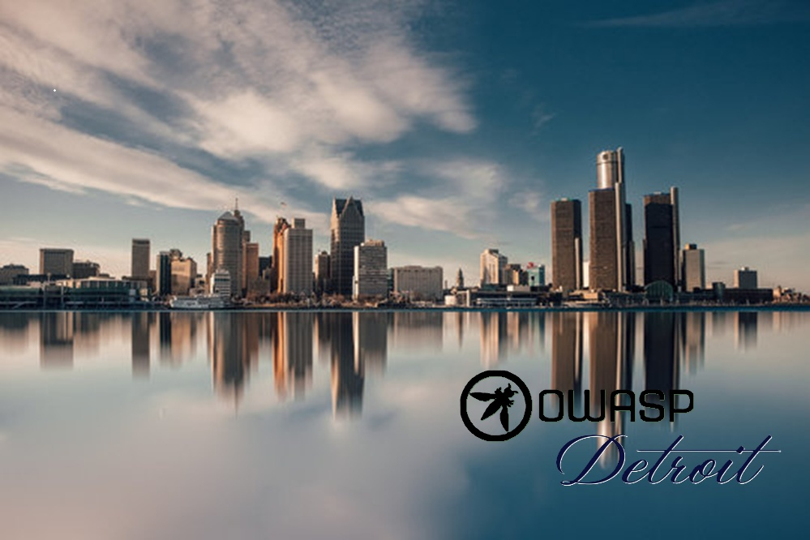

---

layout: col-sidebar
title: OWASP Detroit
tags: OWASP-Detroit OWASP Detroit
level: 0
region: United States

auto-migrated: 1
meetup-group: OWASP-Detroit-Chapter
country: USA
postal-code: 48168

---

## Welcome to the OWASP Detroit chapter

Welcome to the revitalized OWASP Detroit chapter. This newly vitalized local chapter builds on the experience of seasoned cybersecurity professionals.
The goal of this chapter is to promote Application Security in the age of AI and beyond.

## OWASP - Who we are and what we do?

The Open Web Application Security Project (OWASP) is a nonprofit foundation that works to improve the security of software. All of our projects ,tools, documents, forums, and chapters are free and open to anyone interested in improving application security. 

Chapters are led by local leaders in accordance with the [Chapter Leader Handbook](/www-policy/rules-of-procedure/chapter-handbook). Financial contributions should only be made online using the authorized online donation button. To be a SPEAKER at ANY OWASP Chapter in the world simply review the [speaker agreement](/www-policy/speaker-agreement) and then contact the local chapter leader with details of what OWASP Project, independent research, or related software security topic you would like to present.

Everyone is welcome and encouraged to participate in our [Projects](/projects), [Local Chapters](/chapters), [Events](/events), [Online Groups](https://groups.google.com/a/owasp.com/), and [Community Slack Channel](https://owasp.slack.com/). We especially encourage diversity in all our initiatives. OWASP is a fantastic place to learn about application security, to network, and even to build your reputation as an expert. We also encourage you to be [become a member](/membership) or consider a [donation](/donate) to support our ongoing work.

[Join OWASP](https://owasp.org/membership)!

## OWASP Detroit Chapter Leadership

If you want to know more about the OWASP Detroit chapter then please mail below chapter leaders/founding members:

* [Enida Metaj](mailto:enida13m@gmail.com)
* [Peeyush Srivastava](mailto:peeyushsri@owasp.org)
* [Sandip Dholakia](mailto:sandipd@owasp.org)

## Chapter Meetings

Stay tuned for more information.

## Local News
- Meeting Location (Coming soon)
- Everyone is welcome to join us at our chapter meetings.
